

  <a href="https://letsbegincode.github.io/"><picture><source media="(prefers-color-scheme: dark)" srcset="assets/banner-dark.svg" /><source media="(prefers-color-scheme: light)" srcset="assets/banner-light.svg" /></picture></a>

<strong>Backend systems &nbsp;&middot;&nbsp; Cloud infrastructure &nbsp;&middot;&nbsp; Applied ML</strong>

  <a href="https://letsbegincode.github.io/"><picture><source media="(prefers-color-scheme: dark)" srcset="assets/link-portfolio-dark.svg" /><source media="(prefers-color-scheme: light)" srcset="assets/link-portfolio-light.svg" /></picture></a>
  <a href="https://letsbegincode.github.io/general/Abhinav_Ranjan_Sulabh_Resume.pdf"><picture><source media="(prefers-color-scheme: dark)" srcset="assets/link-resume-dark.svg" /><source media="(prefers-color-scheme: light)" srcset="assets/link-resume-light.svg" /></picture></a>
  <a href="https://www.linkedin.com/in/abhinav-ranjan-sulabh"><picture><source media="(prefers-color-scheme: dark)" srcset="assets/link-linkedin-dark.svg" /><source media="(prefers-color-scheme: light)" srcset="assets/link-linkedin-light.svg" /></picture></a>
  <a href="mailto:abhinavranjan.dev@gmail.com"><picture><source media="(prefers-color-scheme: dark)" srcset="assets/link-email-dark.svg" /><source media="(prefers-color-scheme: light)" srcset="assets/link-email-light.svg" /></picture></a>

  <a href="https://www.kaggle.com/rootpi3">Kaggle</a> &nbsp;&middot;&nbsp;
  <a href="https://x.com/r_abhinav_s">X / Twitter</a>

<h2><picture><source media="(prefers-color-scheme: dark)" srcset="assets/section-about-dark.svg" /><source media="(prefers-color-scheme: light)" srcset="assets/section-about-light.svg" /></picture></h2>

I build <strong>Java and Python systems</strong>, from database-backed APIs to cloud deployment workflows.

<picture><source media="(prefers-color-scheme: dark)" srcset="assets/about-current-dark.svg" /><source media="(prefers-color-scheme: light)" srcset="assets/about-current-light.svg" />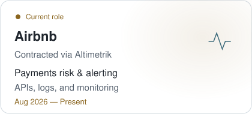</picture>
<picture><source media="(prefers-color-scheme: dark)" srcset="assets/about-background-dark.svg" /><source media="(prefers-color-scheme: light)" srcset="assets/about-background-light.svg" />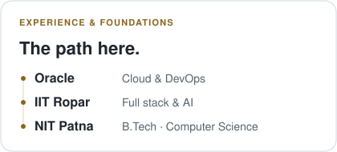</picture>

<h2><picture><source media="(prefers-color-scheme: dark)" srcset="assets/section-projects-dark.svg" /><source media="(prefers-color-scheme: light)" srcset="assets/section-projects-light.svg" />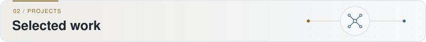</picture></h2>

<a href="https://github.com/letsbegincode/Banking-System"><picture><source media="(prefers-color-scheme: dark)" srcset="assets/project-banking-dark.svg" /><source media="(prefers-color-scheme: light)" srcset="assets/project-banking-light.svg" />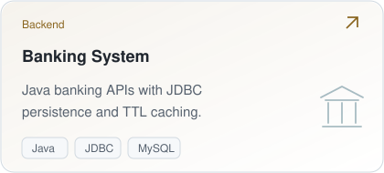</picture></a>
<a href="https://github.com/letsbegincode/dns-system-java"><picture><source media="(prefers-color-scheme: dark)" srcset="assets/project-dns-dark.svg" /><source media="(prefers-color-scheme: light)" srcset="assets/project-dns-light.svg" />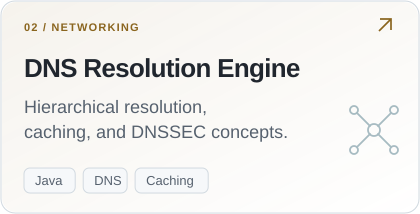</picture></a>
<a href="https://github.com/letsbegincode/european-power-fair-value-forecasting"><picture><source media="(prefers-color-scheme: dark)" srcset="assets/project-forecasting-dark.svg" /><source media="(prefers-color-scheme: light)" srcset="assets/project-forecasting-light.svg" />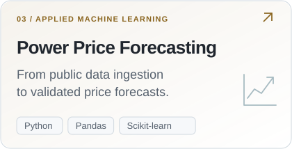</picture></a>
<a href="https://github.com/letsbegincode/Fed_IIDS"><picture><source media="(prefers-color-scheme: dark)" srcset="assets/project-federated-dark.svg" /><source media="(prefers-color-scheme: light)" srcset="assets/project-federated-light.svg" />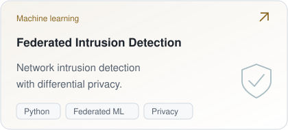</picture></a>

<h2><picture><source media="(prefers-color-scheme: dark)" srcset="assets/section-toolkit-dark.svg" /><source media="(prefers-color-scheme: light)" srcset="assets/section-toolkit-light.svg" />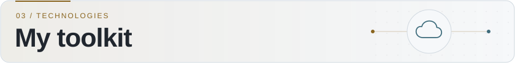</picture></h2>

<picture><source media="(prefers-color-scheme: dark)" srcset="assets/toolkit-languages-dark.svg" /><source media="(prefers-color-scheme: light)" srcset="assets/toolkit-languages-light.svg" />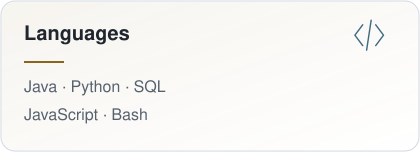</picture>
<picture><source media="(prefers-color-scheme: dark)" srcset="assets/toolkit-backend-dark.svg" /><source media="(prefers-color-scheme: light)" srcset="assets/toolkit-backend-light.svg" />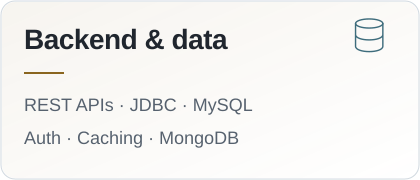</picture>
<picture><source media="(prefers-color-scheme: dark)" srcset="assets/toolkit-cloud-dark.svg" /><source media="(prefers-color-scheme: light)" srcset="assets/toolkit-cloud-light.svg" />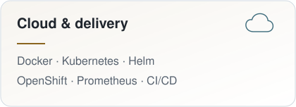</picture>
<picture><source media="(prefers-color-scheme: dark)" srcset="assets/toolkit-ml-dark.svg" /><source media="(prefers-color-scheme: light)" srcset="assets/toolkit-ml-light.svg" />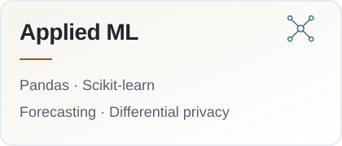</picture>

Explore my computer science foundations

Data structures and algorithms, operating systems, computer networks, multithreading, object-oriented design, and system design.

<h2><picture><source media="(prefers-color-scheme: dark)" srcset="assets/section-activity-dark.svg" /><source media="(prefers-color-scheme: light)" srcset="assets/section-activity-light.svg" />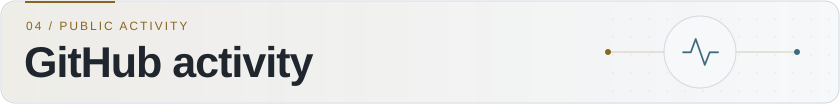</picture></h2>

<picture><source media="(prefers-color-scheme: dark)" srcset="profile/stats-dark.svg" /><source media="(prefers-color-scheme: light)" srcset="profile/stats-light.svg" /></picture>
<picture><source media="(prefers-color-scheme: dark)" srcset="profile/languages-dark.svg" /><source media="(prefers-color-scheme: light)" srcset="profile/languages-light.svg" /></picture>

Public GitHub activity, refreshed daily. Languages reflect repository code, not proficiency or coding time.

<h2><picture><source media="(prefers-color-scheme: dark)" srcset="assets/contact-dark.svg" /><source media="(prefers-color-scheme: light)" srcset="assets/contact-light.svg" />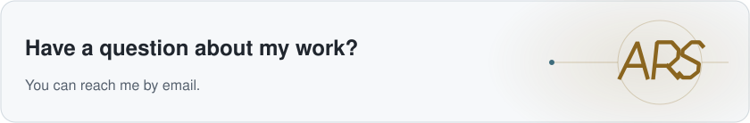</picture></h2>

<a href="https://letsbegincode.github.io/"><picture><source media="(prefers-color-scheme: dark)" srcset="assets/link-portfolio-dark.svg" /><source media="(prefers-color-scheme: light)" srcset="assets/link-portfolio-light.svg" /></picture></a>
<a href="mailto:abhinavranjan.dev@gmail.com"><picture><source media="(prefers-color-scheme: dark)" srcset="assets/link-email-dark.svg" /><source media="(prefers-color-scheme: light)" srcset="assets/link-email-light.svg" /></picture></a>

